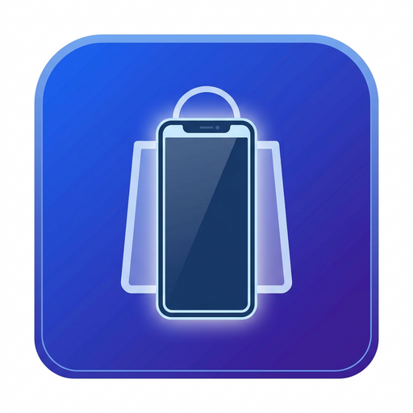

<p align="center">
  
</p>

<h1 align="center">📱 MOBPOS — نظام إدارة محلات الموبايلات المتكامل (v1.0.25)</h1>

<p align="center">
  <b>المنظومة السحابية والهجينة الأولى في الوطن العربي المتخصصة 100% في إدارة محلات الموبايلات والإكسسوارات والصيانة</b><br/>
  <sub>سطح المكتب (Desktop Windows) + تطبيق الموبايل المصاحب (Android & iOS) + مزامنة سحابية لحظية أوفلاين أولاً (Offline-First)</sub>
</p>

<p align="center">
  <a href="https://github.com/msharaf221/MOBPOS-V2/releases/latest">
    
  </a>
  
  
  
  
  
  
  
</p>

<p align="center">
  <a href="#-روابط-التحميل-المباشرة">التحميل المباشر</a> •
  <a href="#-منظومة-mobpos-المتكاملة">عناصر المنظومة</a> •
  <a href="#-تطبيق-الموبايل-المصاحب-companion-app">تطبيق الموبايل</a> •
  <a href="#-محرك-المزامنة-السحابية-cloud-auto-sync-v21">المزامنة السحابية</a> •
  <a href="#-نظام-الشبكة-المحلية-lan-hub">الشبكة المحلية (LAN)</a> •
  <a href="#-المميزات-الرئيسية-للنظام">المميزات</a> •
  <a href="#-التثبيت-والتشغيل">التشغيل والتطوير</a>
</p>

---

## 📥 روابط التحميل المباشرة (Direct Downloads)

يمكنك دائماً تنزيل أحدث الإصدارات الجاهزة للعمل والإنتاج من صفحة [GitHub Releases v1.0.25](https://github.com/msharaf221/MOBPOS-V2/releases/latest):

| المنصة | نوع الملف | الوصف | رابط التحميل |
|---|---|---|:---:|
| 💻 **ويندوز (سطح المكتب)** | `MOBPOS-Setup-1.0.25.exe` | برنامج التثبيت الرسمي لويندوز مع التحديث التلقائي | [تحميل Setup EXE](https://github.com/msharaf221/MOBPOS-V2/releases/download/v1.0.25/MOBPOS-Setup-1.0.25.exe) |
| 🧳 **ويندوز (نسخة محمولة)** | `MOBPOS-1.0.25-Portable.exe` | تشغيل فوري من فلاشة USB بدون تثبيت | [تحميل Portable EXE](https://github.com/msharaf221/MOBPOS-V2/releases/download/v1.0.25/MOBPOS-1.0.25-Portable.exe) |
| 🤖 **أندرويد (تطبيق الكاشير والمدير)** | `mobpos-companion-v1.0.25.apk` | تطبيق أندرويد نيتف سريع وخفيف للأجهزة اللوحية والموبايل | [تحميل Android APK](https://github.com/msharaf221/MOBPOS-V2/releases/download/v1.0.25/mobpos-companion-v1.0.25.apk) |
| 🍏 **آيفون / آيباد (iOS)** | `mobpos-companion-ios-v1.0.25.zip` | حزمة Xcode و IPA لتثبيت التطبيق على أجهزة أبل | [تحميل حزمة iOS](https://github.com/msharaf221/MOBPOS-V2/releases/download/v1.0.25/mobpos-companion-ios-v1.0.25.zip) |
| 🌐 **تطبيق الويب و PWA** | Web Browser / LAN | تشغيل عبر المتصفح المحلي أو شبكة الواي فاي بدون إنترنت | [افتح المتصفح](http://127.0.0.1:8420) |

---

## 🏛️ منظومة MOBPOS المتكاملة

صُمم **MOBPOS** ليكون حلاً جذرياً لأصحاب محلات الموبايل، حيث يدمج 4 ركائز تكنولوجية في منصة واحدة متجانسة:

```
                        ┌──────────────────────────────────────────────┐
                        │          ☁️ سحابة Supabase Postgres          │
                        │  - mobpos_records (تعديلات لحظية دقيقة)      │
                        │  - mobpos_stores (لقطات شاملة للمخازن)       │
                        │  - سياسات RLS مجهزة وعزل الفروع (tenant_id)   │
                        └──────────────────────┬───────────────────────┘
                                               │
                                 WebSocket Realtime + REST API
                                               │
             ┌─────────────────────────────────┼─────────────────────────────────┐
             ▼                                 ▼                                 ▼
┌───────────────────────────┐    ┌───────────────────────────┐    ┌───────────────────────────┐
│  🖥️ تطبيق الديسكتوب POS   │    │  📱 تطبيق الموبايل المصاحب │    │   📡 خادم الشبكة المحلية  │
│  (Windows Electron App)   │    │   (Android APK & iOS)     │    │       (Local LAN Hub)     │
│ • طباعة حرارية صامتة 80mm │    │ • واجهة Fintech زجاجية فاخرة│    │ • تشغيل الكواشير دون نت   │
│ • إدارة سيريالات وباركود  │    │ • إدارة الفروع المتعددة   │    │ • مشاركة البيانات عبر Wi-Fi│
│ • حفظ تقارير PDF حقيقية   │    │ • مشاركة فواتير واتساب    │    │ • توثيق فوري عبر PIN كاشير │
│ • تحديث تلقائي للبرنامج   │    │ • جرد ومتابعة الخزن الحية │    │ • متوافق مع الموبايل والتاب│
└───────────────────────────┘    └───────────────────────────┘    └───────────────────────────┘
```

---

## 📱 تطبيق الموبايل المصاحب (MOBPOS Companion App)

تطبيق محمول متكامل مبني باستخدام **Capacitor 8** و **React 19**، يمنح صاحب المحل والمدير تحكماً كاملاً من أي مكان:

* **تصميم فاخر بنمط Fintech:** واجهة مستخدم داكنة بزجاجية بلورية (Glassmorphism)، وبطاقات Bento تفاعلية، وشريط تنقل عائم (Floating Dock).
* **إدارة الفروع المتعددة (Multi-Branch Manager):**
  - حفظ ومزامنة فروع متعددة مع حفظ مفاتيح ورابط كل فرع.
  - التبديل الفوري بنقرة واحدة بين الفروع دون إعادة تسجيل الدخول.
  - مؤشر ذكي لحالة اتصال الفرع ونبض المزامنة.
* **مشاركة سريعة عبر الواتساب (1-Tap WhatsApp Sharing):** إرسال تفاصيل الفواتير وإيصالات الاستلام للعملاء بضغطة زر واحدة.
* **لوحة تحكم حية (Live Executive Dashboard):** إجمالي مبيعات اليوم، صافي الأرباح اللحظية، الخزن، الأجهزة المعلقة في الصيانة، ونواقص المخزون.
* **جرد الخزن والتحويلات:** تسجيل وتأكيد المصروفات والإيداعات وتحويلات المحافظ الإلكترونية مباشرة من الهاتف.

---

## ☁️ محرك المزامنة السحابية (Cloud Auto Sync v2.1)

نظام مزامنة سحابي لحظي فائق الاستقرار، مصمم وفق مبادئ **Offline-First** الحقيقية:

* **استقرار بصري تام ومنع الرعشة (Anti-Fluttering State Machine):**
  - معالجة ذكية لحالات الاتصال تمنع وميض وتذبذب بادج المزامنة في شريط العنوان نهائياً.
  - تدرج زمني أسي ذكي لإعادة المحاولة (Exponential Backoff من 5 إلى 60 ثانية) مع سقف أمان يحمي الشبكة من استنزاف الموارد.
* **دورة مزامنة شاملة بنقرة واحدة (`syncNow`):**
  - تفريغ طابور العمليات المعلقة في الأوفلاين (`syncOutbox`) ورفعها فوراً.
  - جلب التعديلات الجديدة الصادرة من الأجهزة الأخرى (`pullCatchUp`).
  - رفع لقطة شاملة للمخازن المالية والمخزون (`pushAllSnapshots`) بترتيب أولويات يحمي استقرار البيانات.
* **التعافي التلقائي وحصانة التخزين (Self-Healing Storage):**
  - حفظ بيانات الاتصال والسيرفر في طبقتين متزامنتين (IndexedDB + localStorage) لضمان عدم فقدان الإعدادات إطلاقاً.
  - كشف تلقائي للجلسات المنتهية والتحويل الفوري لمفتاح Anon Key دون تعطيل الكاشير.
* **مخطط قاعدة بيانات عالمي متوافق (Universal Idempotent Schema v2.1):**
  - متوافق 100% مع أي مشروع Supabase جديد أو قائم.
  - سياسات وصول مفتوحة للصلاحيات (Permissive RLS) تمنع أخطاء الصلاحيات في الاستخدام اليومي.
  - كرت نسخ مباشر لكود SQL من داخل شاشة الإعدادات ونافذة المزامنة بلمسة واحدة.

---

## 📡 نظام الشبكة المحلية (Local LAN Hub)

إذا كان المحل يعاني من ضعف أو انقطاع الإنترنت، يمتلك MOBPOS **خادم شبكة داخلية مدمج (Local LAN Server)**:

* **ربط هواتف الكاشير والتابلت بجهاز الكمبيوتر الرئيسي:** مشاركة نفس شبكة الواي فاي بدون الحاجة لاتصال خارجي بالإنترنت.
* **اكتشاف تلقائي للعناوين:** يكتشف النظام عناوين IP المحلية تلقائياً ويعرض رابطاً سريعاً يمكن فتحه من أي هاتف.
* **مصادقة آمنة عبر PIN:** تسجيل دخول سريع للموظفين والكاشير عبر رمز PIN المخصص للمتجر.

---

## ✨ المميزات الرئيسية للنظام

### 🛒 نقطة بيع احترافية وسريعة (Ultra-Fast POS)
- **مسح باركود فوري:** دعم كافة أجهزة قراءة الباركود السلكية واللاسلكية وكاميرات الموبايل.
- **توليد باركود EAN-13 معتمد:** كود مصري ببادئة `622` مع حساب خانة التحقق (Check Digit) وطباعة ملصقات الرفوف.
- **ربط سيريال IMEI بالبيع:** اختيار السيريال من القائمة مع ربطه تلقائياً بالفاتورة والعميل والضمان.
- **تعليق الفواتير (Park/Hold):** حفظ سلة مؤقتاً لخدمة عميل آخر والعودة لها فوراً.
- **طرق دفع متعددة:** كاش، فيزا/بطاقة، محافظ إلكترونية، أو آجل على حساب العميل.
- **طباعة حرارية صامتة:** طباعة إيصالات 80mm مباشرة للطابعة الافتراضية بدون نوافذ متصفح مزعجة.

### 📱 إدارة أرقام IMEI والضمان
- تتبع كامل لكل جهاز برقمه التسلسلي الفريد (`IMEI1` + `IMEI2`).
- تسجيل اللون، السعة، الحالة (جديد / كسر زيرو / مستعمل)، وسعر التكلفة وسعر البيع.
- **متابعة الضمان:** عداد ذكي يوضح الأيام المتبقية وتنبيه بالأجهزة التي شارف ضمانها على الانتهاء.
- سجل تاريخي لكل جهاز: مين استورده، مين باعه، تاريخ الخروج، وهل خضع للصيانة.

### 🔧 إدارة قسم الصيانة وقطع الغيار
- **تذكرة صيانة برقم تلقائي:** تسجيل بيانات العميل، نوع الجهاز، العطل، وكلمة سر قفل الشاشة.
- **لوحة كانبان (Kanban Board):** استعراض التذاكر (مستلم ⬅️ تحت الفحص ⬅️ تم الإصلاح ⬅️ تم التسليم).
- **خصم قطع الغيار من المخزون تلقائياً:** حساب تكلفة الشاشة أو البطارية ومصنعية الفني وأرباح الصيانة بدقة.
- طباعة إيصال استلام احترافي للعميل مع الشروط والأحكام.

### 💰 الخزائن المتعددة والمعاملات المالية
- خزائن منفصلة: الخزنة النقدية بالمحل، محافظ فودافون كاش / اتصالات كاش، والحسابات البنكية.
- تسجيل تحويلات الخزن مع تسجيل عمولات عمليات السحب والإيداع وحساب الأرباح الناتجة عنها.
- شجرة حسابات جانبية (Side Accounts) للديون والمستحقات الخارجية والشركاء.

### 👥 العملاء، الموردين، والمرتجعات
- كشف حساب تفصيلي لكل عميل ولكل مورد مع تتبع الأرصدة والمدفوعات الآجلة.
- معالجة المرتجعات الآمنة: استرجاع البضاعة للمخزن وتعديل الخزينة أو رصيد العميل أوتوماتيكياً.
- فواتير توريد ومشتريات بالكميات أو بأرقام IMEI دفعة واحدة.

### 📊 التقارير والإغلاق اليومي
- تقرير تقفيل اليومية (Daily Closing Report): صافي الكاش، الأرباح، المبيعات، والمصروفات.
- تصدير كامل إلى **Excel (XLSX)** بدعم كامل للغة العربية.
- تصدير وحفظ تقارير **PDF** رسمية قابلة للأرشفة والطباعة.

---

## 🛡️ الأمان والاعتمادية

| الميزة | التفاصيل الفنية |
|---|---|
| **تشفير كلمات المرور** | معيار `PBKDF2-HMAC-SHA-256` مع ملح عشوائي (Salt) فريد لكل مستخدم |
| **مفاتيح التراخيص الرقمية** | توقيع تشفيري غير متماثل عبر خوارزمية `ECDSA P-256` وبصمة الجهاز |
| **قاعدة البيانات المحلية** | `IndexedDB v8` سريعة جداً بدون أي حد أقصى للبيانات سوى مساحة القرص |
| **حماية الشبكة في Electron** | سياسة أمان محتوى صارمة (CSP) محدثة تمنع تسريب البيانات وتحمي الاتصالات |
| **نسخ احتياطي متعدد** | نسخ احتياطي محلي دوري + نسخ احتياطي سحابي تلقائي على Google Drive |

---

## 🧪 الجودة والاختبارات التلقائية (124 Tests + E2E)

يخضع نظام **MOBPOS-V2** لفحص شامل ومستمر عبر حزمة اختبارات برمجية تغطي كافة السيناريوهات الحسابية والتشغيلية:

```bash
# تشغيل اختبارات الوحدة (124 اختباراً)
npm test

# تشغيل اختبار دورة المبيعات الشاملة المتكاملة (E2E POS Sales Cycle)
npm run test:e2e

# تشغيل الفحص الكامل مع فحص الأنواع
npm run test:all
```

* ✅ **124 اختبار وحدة ناجح بنسبة 100%:** يشمل محرك تسلسل الفواتير، الحسابات المالية، تشفير كلمات المرور، فحص الـ JWT، توليد الباركود، ومنطق المزامنة.
* ✅ **اختبار Playwright E2E:** محاكاة حقيقية لعملية بيع كاملة في نقطة البيع (مسح الصنف ⬅️ تطبيق خصم ⬅️ اختيار الخزنة ⬅️ إنهاء الفاتورة ⬅️ طباعة الإيصال ⬅️ خصم المخزن ⬅️ عمل مرتجع واستعادة الكمية).

---

## 🛠️ متطلبات التثبيت والتشغيل للمطورين

### المتطلبات
- **Node.js 20+** (LTS)
- **npm** (أو yarn / pnpm)

### التشغيل المحلي
```bash
# 1. استنساخ المستودع
git clone https://github.com/msharaf221/MOBPOS-V2.git
cd MOBPOS-V2

# 2. تثبيت الاعتماديات
npm install

# 3. تشغيل خادم التطوير (Web)
npm run dev

# 4. تشغيل نسخة سطح المكتب (Electron Dev)
npm run electron:dev
```

### أوامر بناء حزم الإنتاج
```bash
# بناء حزمة الويب المضغوطة
npm run build

# بناء تطبيق ويندوز المثبت (Installer EXE)
npm run dist:win

# بناء تطبيق ويندوز المحمول (Portable EXE)
npm run dist:win:portable

# بناء تطبيق الموبايل (Android & iOS Web Assets)
npm run mobile:build
```

---

## 📐 هيكل المجلدات الرئيسي

```
MOBPOS-V2/
├── src/                    # كود تطبيق الويب وسطح المكتب الأساسي
│   ├── components/         # شاشات الواجهة (POS, Inventory, Maintenance, etc.)
│   ├── hooks/              # خطافات إدارة الحالة وقاعدة البيانات والمزامنة
│   ├── services/           # محرك المزامنة اللحظية (SyncEngine.ts)
│   ├── license/            # محرك التحقق من التراخيص وبصمة الأجهزة
│   └── utils/              # دوال مساعدة للتقارير، الباركود، الطباعة، وSQL
├── mobile/                 # تطبيق الموبايل المصاحب (Capacitor 8)
│   ├── src/                # شاشات الموبايل وإدارة الفروع المتعددة
│   ├── android/            # مشروع أندرويد نيتف (Gradle / Android Studio)
│   └── ios/                # مشروع أبل نيتف (Xcode / SwiftPM)
├── electron/               # العملية الرئيسية لسطح المكتب وإدارة النوافذ والـ CSP
├── supabase/
│   └── schema.sql          # مخطط قاعدة البيانات السحابية الشامل والمحدث v2.1
├── tests/
│   └── e2e/                # اختبارات دورة البيع الشاملة المتكاملة (Playwright)
└── .github/workflows/      # خطوط الإنتاج السحابية (Release, Android APK, iOS)
```

---

## 🤝 المساهمة والتطوير

نرحب دائماً بالمساهمات التطويرية والأفكار المبتكرة:
1. افتح **Issue** لمناقشة التعديلات المقترحة.
2. قم بعمل **Fork** للمستودع.
3. أنشئ فرعاً لميزتك (`git checkout -b feature/amazing-feature`).
4. ارفع التغييرات في **Pull Request**.

---

<p align="center">
  <b>صُنع بـ ❤️ لتطوير وتيسير تجارة الموبايل في مصر والوطن العربي</b><br/>
  <sub>MOBPOS — القوة، السرعة، والاعتمادية في نظام واحد</sub>
</p>
